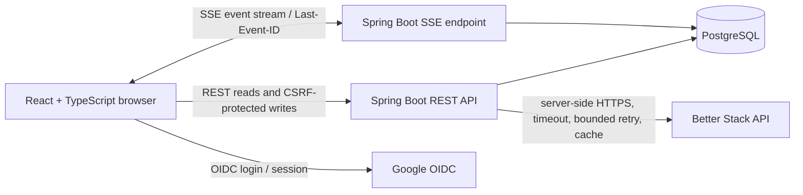
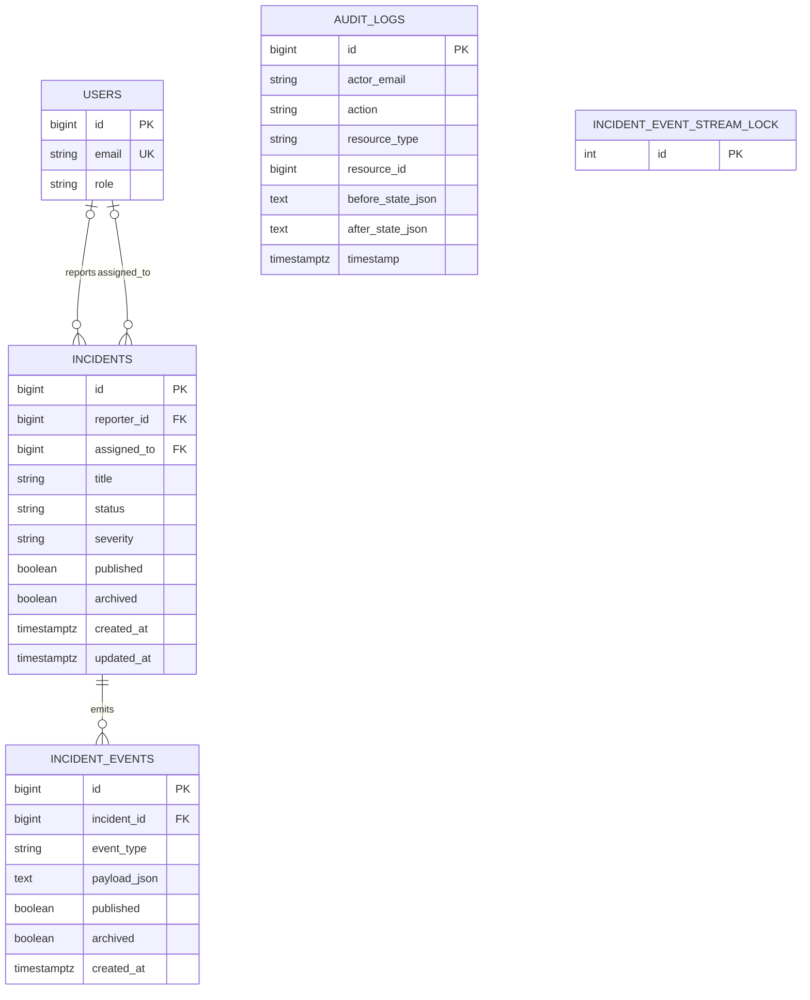

## Incident visibility and event flow

Authenticated viewers can submit reports. A new report and its `CREATED` event
are stored as unpublished; only operators can see the pending queue and
publish, edit, or archive reports. Public incident reads and streams include
published reports only. Archiving hides a report from active views but retains
the incident, audit entry, and event history. Audit actors come from the
validated OIDC identity. All writes use the REST API with a session CSRF token;
the browser's SSE connection is read-only.

`audit_logs.resource_id` is a logical resource reference rather than a foreign
key, so the audit trail can remain append-only independently of resource
lifecycle. The V4 index `idx_incidents_visibility_created_at` begins with the
publication/archive filters and orders by creation time, supporting the
public and operator active-incident queries without sorting the whole table.
V5 adds `idx_audit_logs_resource_history` to support a resource's audit timeline;
it can be dropped without changing stored audit records.