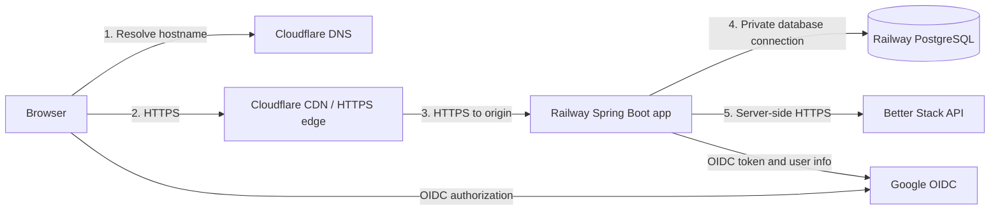
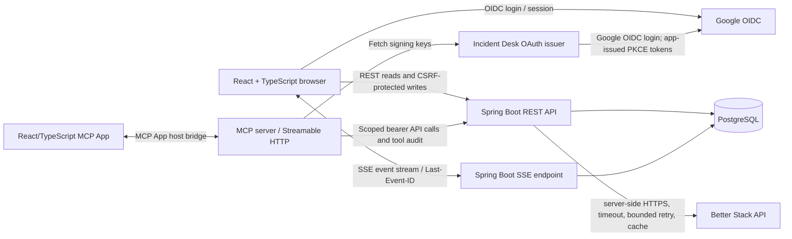
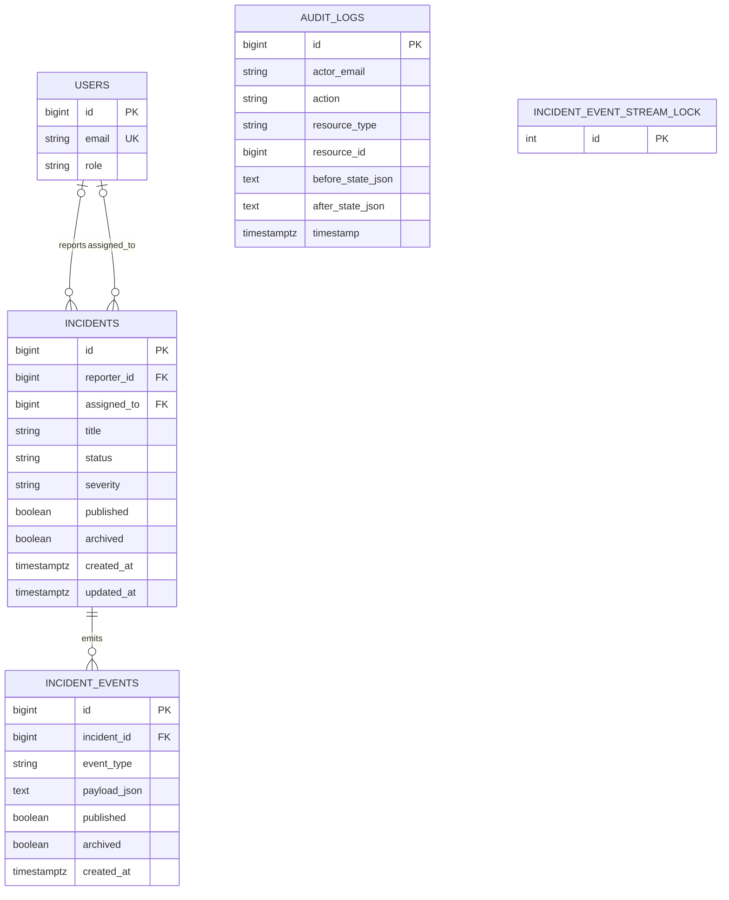

## Public request path and trust boundaries

The browser and DNS are outside the application trust boundary. Cloudflare
terminates public HTTPS before forwarding to Railway's HTTPS origin. The app
validates identity and authorization; neither the CDN nor the browser makes
authorization decisions. The database and app are separate Railway services
using private networking. Better Stack and Google are external providers:
credentials stay on the server, and provider responses are validated. Public
assets may be cached at the edge; HTML, API data, and authenticated responses
use `no-store`.

## Application and MCP flow

## Incident visibility and event flow

Authenticated viewers can submit reports. A new report and its `CREATED` event
are stored as unpublished; only operators can see the pending queue and
publish, edit, or archive reports. Public incident reads and streams include
published reports only. Archiving hides a report from active views but retains
the incident, audit entry, and event history. Audit actors come from the
validated identity. Browser writes use the REST API with a session CSRF token;
the browser's SSE connection is read-only. MCP requests use short-lived
audience-bound bearer tokens issued after Google OIDC login. MCP tools enforce
per-tool scopes at both the MCP server and backend, and incident submission
is designed to require user confirmation before creating a private report.
The recorded host could not complete that confirmation; see
[MCP host exercise](mcp.md#host-exercise).

`audit_logs.resource_id` is a logical resource reference rather than a foreign
key, allowing audit records to outlive the referenced resource. The staging
application role can nevertheless update or delete those records, so
database-level append-only protection is not enforced; see the
[audit evidence](evidence/F6-audit.txt). The V4 index `idx_incidents_visibility_created_at` begins with the
publication/archive filters and orders by creation time, supporting the
public and operator active-incident queries without sorting the whole table.
V5 adds `idx_audit_logs_resource_history` to support a resource's audit timeline;
it can be dropped without changing stored audit records.